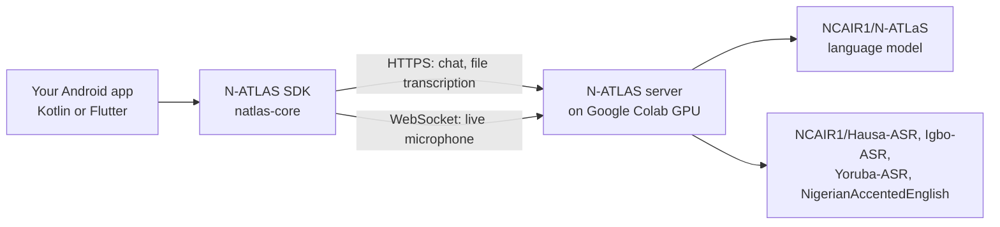

# N-ATLAS SDK for Android

**Add Hausa, Igbo, Yoruba and Nigerian English voice and chat to an Android
app, from Kotlin or Flutter. Live microphone input and a one-call voice
pipeline (speak, transcribe, ask N-ATLaS, get a reply), on a real phone.**

> **Status: early build for NAIC 2026. API v0.1 draft.** Names may change
> before v1. Progress is tracked in [`docs/STATUS.md`](docs/STATUS.md).

N-ATLAS is an initiative of the Federal Ministry of Communications,
Innovation and Digital Economy, and powered by Awarri Technologies.

---

## What it does

| Feature | Kotlin | Flutter | N-ATLAS model behind it |
| --- | --- | --- | --- |
| Transcribe an audio file | `client.asr.transcribe(...)` | `client.asr.transcribe(...)` | One speech model per language (below) |
| Live microphone transcription: words appear as you speak | `client.asr.live(...)` | `client.asr.live(...)` | Same speech models |
| Chat, with replies streamed word by word | `client.chat.stream(...)` | `client.chat.stream(...)` | `NCAIR1/N-ATLaS` |
| Voice pipeline: mic, then speech to text, then N-ATLaS, then the reply on screen | `client.voice.converse(...)` | `client.voice.converse(...)` | Speech model + `NCAIR1/N-ATLaS` |

Four languages:

| Language | SDK value | Speech model |
| --- | --- | --- |
| Hausa | `Language.HAUSA` | `NCAIR1/Hausa-ASR` |
| Igbo | `Language.IGBO` | `NCAIR1/Igbo-ASR` |
| Yoruba | `Language.YORUBA` | `NCAIR1/Yoruba-ASR` |
| Nigerian-accented English | `Language.ENGLISH` | `NCAIR1/NigerianAccentedEnglish` |

**What it does not do yet:**
- **No spoken replies.** N-ATLAS has no text-to-speech model yet, so replies
  come back as text. The pipeline has a slot for it when one exists.
- **No offline mode.** N-ATLaS has 8 billion parameters, too big for most
  phones. The SDK sends audio and text to a server and gets results back.
- **Android only** for now, including the Flutter plugin.
- **No Pidgin.** N-ATLaS does not support it.

The SDK only ever calls N-ATLAS models (`NCAIR1/*`). It has no fallback to
any other model.

---

## How it fits together



```
Phone                          Server (Google Colab GPU, for now)     Hugging Face
+---------------------+        +------------------------------+       +---------------------------+
| Your app            |        | FastAPI, OpenAI-compatible   |       | NCAIR1/N-ATLaS            |
|  Kotlin or Flutter  | -----> |  /v1/chat/completions (SSE)  | <---- | NCAIR1/Hausa-ASR          |
|  natlas-core (SDK)  |  HTTPS |  /v1/audio/transcriptions    | loads | NCAIR1/Igbo-ASR           |
|  mic capture        |  + WS  |  /v1/audio/live (WebSocket)  |       | NCAIR1/Yoruba-ASR         |
+---------------------+        +------------------------------+       | NCAIR1/NigerianAccented.. |
                                                                       +---------------------------+
```

- The Flutter plugin is a thin layer over the Kotlin library, so both behave
  the same.
- The server speaks the OpenAI request format. If NCAIR publishes an official
  API in that format, you change the server address and nothing else.
- The server address is always a setting. The Colab test server's address
  changes each time it restarts.

---

## Quickstart (API v0.1 draft)

You need a running N-ATLAS server: its address and an API key. See
[Server](#server) to run your own.

**Never put the key in your app's code or assets.** In the samples it is read
from `local.properties` (Kotlin) or `--dart-define` (Flutter), and neither is
committed. In a real app, get a short-lived key from your own backend.

### Kotlin

```kotlin
// build.gradle.kts
dependencies {
    implementation("io.github.baffaabba:natlas-core:0.1.0") // not yet published; see note
}
```

> **Not on Maven Central yet.** Until the first release, include
> `android/natlas-core` from this repo as a module. TODO (android): exact
> steps once the Gradle project exists.

```kotlin
val client = NAtlasClient(
    NAtlasConfig(
        baseUrl = "https://<your-server>",
        apiKey = BuildConfig.NATLAS_API_KEY,
    )
)

// Transcribe a file
val transcript = client.asr.transcribe(File(path), Language.HAUSA)

// Stream a chat reply
client.chat.stream(listOf(ChatMessage.user("Sannu! Yaya kake?")))
    .collect { delta -> print(delta.text) }

// Voice pipeline: mic → speech to text → N-ATLaS → reply (needs RECORD_AUDIO)
val turn = client.voice.converse(Language.HAUSA)
turn.events.collect { e ->
    when (e) {
        is VoiceEvent.Heard -> showHeard(e.text)
        is VoiceEvent.Reply -> appendReply(e.delta)
        else -> {}
    }
}
```

### Flutter

```yaml
# pubspec.yaml
dependencies:
  natlas_sdk:
    git:
      url: <repo-url>          # TODO: fill in once the repo is public
      path: flutter/natlas_sdk
```

```dart
final client = NAtlasClient(NAtlasConfig(
  baseUrl: const String.fromEnvironment('NATLAS_BASE_URL'),
  apiKey: const String.fromEnvironment('NATLAS_API_KEY'),
));

final t = await client.asr.transcribe('/path/clip.wav', Language.hausa);

await for (final d in client.chat.stream([ChatMessage.user('Sannu!')])) {
  print(d.text);
}

final turn = await client.voice.converse(Language.hausa);
```

```
flutter run --dart-define=NATLAS_BASE_URL=https://<your-server> --dart-define=NATLAS_API_KEY=<key>
```

Full API, errors and threading rules: [`docs/API.md`](docs/API.md).

### Microphone and privacy

- The SDK asks for the microphone only when you start listening. Your app
  should explain why first.
- It never records in the background.
- The SDK does not store or log audio on the phone.

---

## Server

The SDK needs a server that runs the N-ATLAS models. For testing we run one
on Google Colab with a free or paid GPU. Setup, the Colab notebook and the
Hugging Face access steps are in [`server/README.md`](server/README.md).

The N-ATLAS models are gated on Hugging Face. To run your own server you
need a Hugging Face account that has accepted the terms on all five
`NCAIR1/*` repos, and an access token. The token stays on the server. It
never goes into an app.

---

## Licence and attribution

**N-ATLAS is an initiative of the Federal Ministry of Communications,
Innovation and Digital Economy, and powered by Awarri Technologies.**

The N-ATLAS models are released under the "Open-Source Research and
Innovation License". In plain words: you may use them free of charge for up
to **1,000 active end users in any rolling 30 days**. Past that, you need a
commercial licence from Awarri (datasupport@awarri.com). The server counts
active users with an anonymous id per install, so you can see when you are
getting close. Every app and page that uses N-ATLAS must show the
attribution line above. The SDK exposes it as `NAtlasClient.ATTRIBUTION`.

**Banned uses.** The licence forbids using N-ATLAS for surveillance,
profiling, disinformation or military purposes. Do not build those with
this SDK.

N-ATLaS appears to be built on Llama 3.1, so the Llama 3.1 Community
Licence may also apply. We have not confirmed this.

The SDK's own code (this repo, not the models) is under the Apache License
2.0. TODO: add the `LICENSE` file before release. The models keep their own
licence above.

---

## Docs

- [`docs/API.md`](docs/API.md): the API contract (wire protocol, Kotlin, Dart)
- [`docs/N-ATLAS-INTEGRATION.md`](docs/N-ATLAS-INTEGRATION.md): which model serves which call, with real examples
- [`server/README.md`](server/README.md): run the server
- [`docs/validation/`](docs/validation/): feedback from external testers
- [`docs/DECISIONS.md`](docs/DECISIONS.md): why we built it this way
- [`docs/STATUS.md`](docs/STATUS.md): what works today, with evidence
